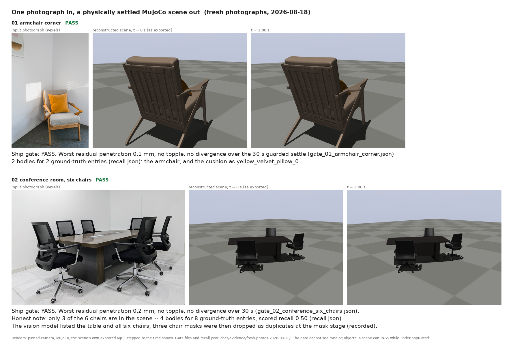
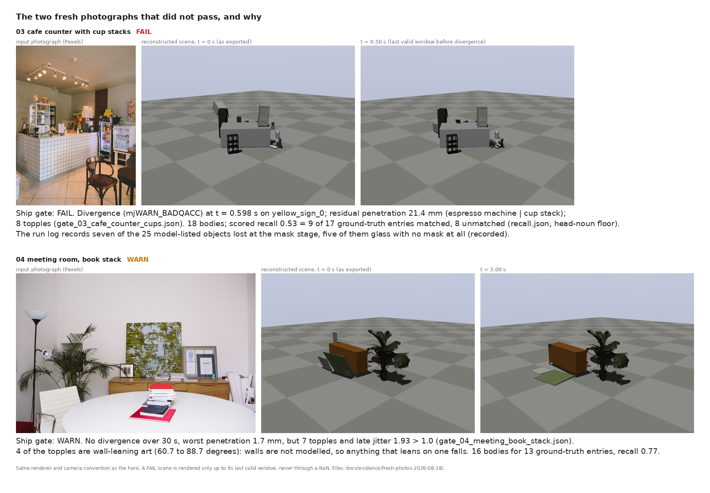
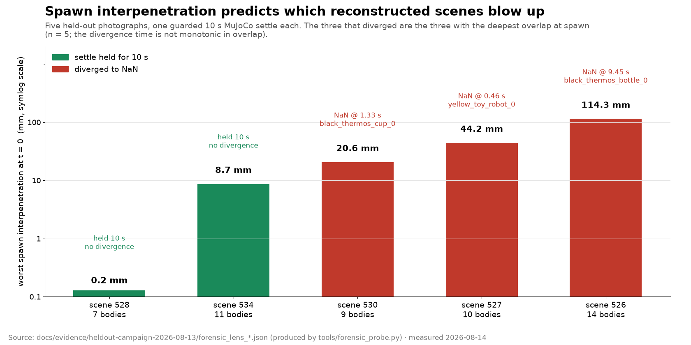
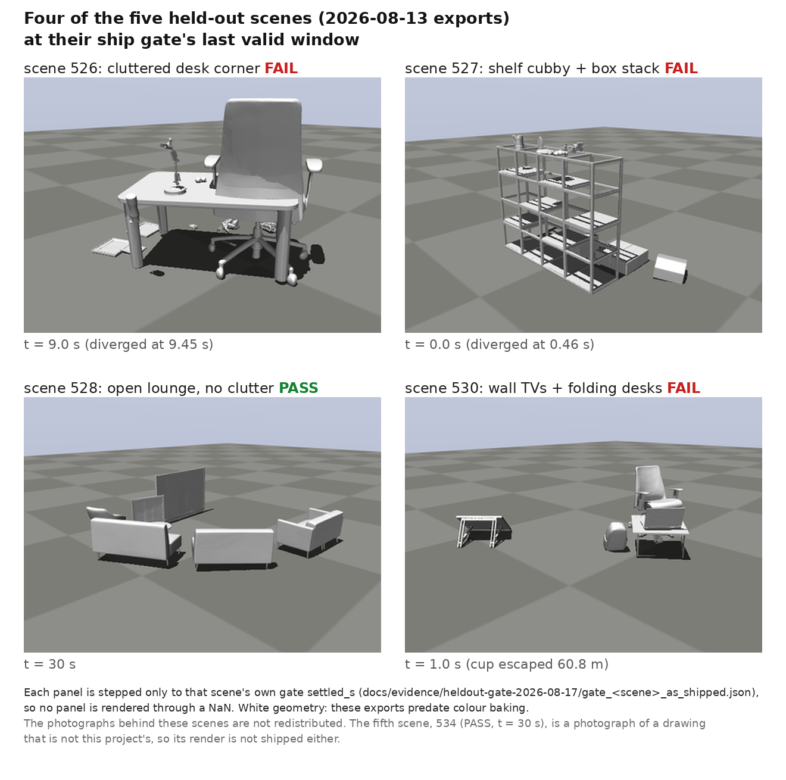
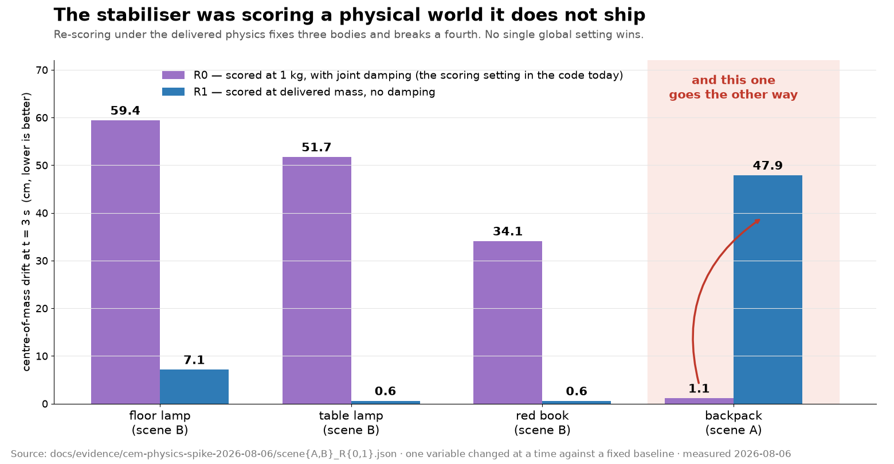
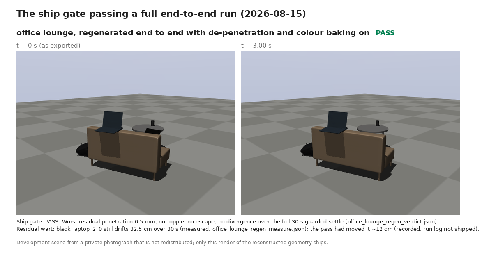
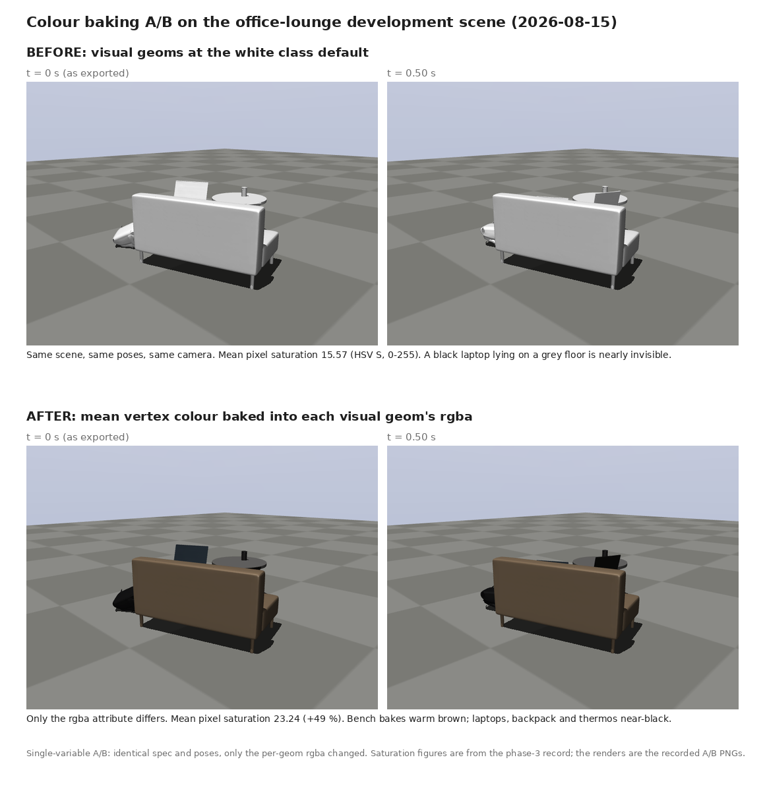
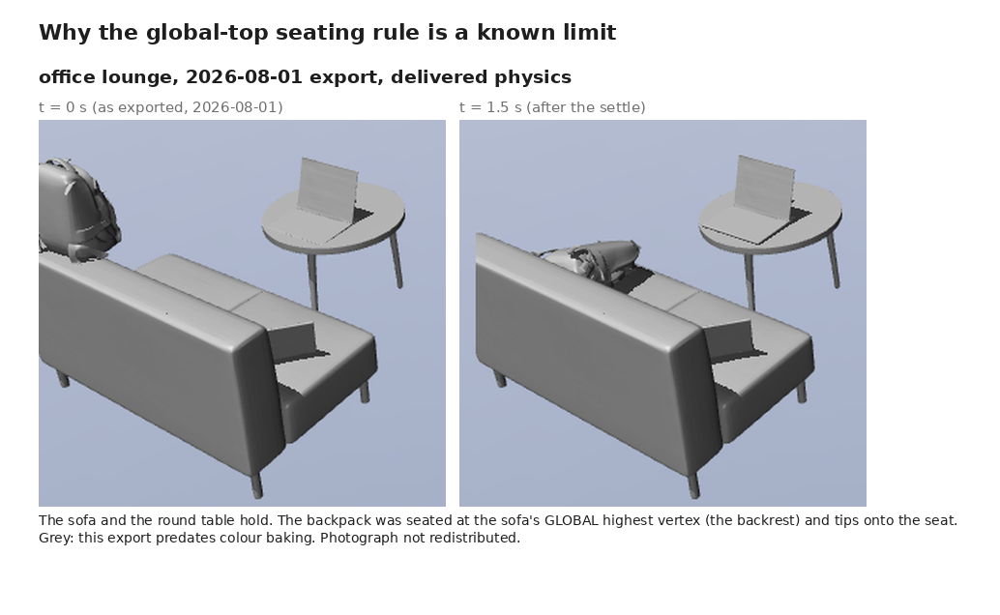
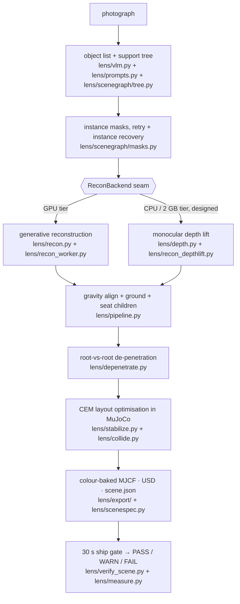

*01 armchair corner — PASS, 0.1 mm residual, 2 of 2 objects · 02 conference
room — PASS, 0.2 mm, scored recall 0.50. Verdicts:
[`docs/evidence/fresh-photos-2026-08-18/`](docs/evidence/fresh-photos-2026-08-18/).*

# MONOLITHCLE

**One photograph in; a MuJoCo/USD scene out whose objects stay where they were
put — and a measurement of when they don't.** Package, CLI and import name:
`lens`.

Python 3.12 · SAM-based instance masks → per-object 3D reconstruction → MuJoCo/USD
export. `pip install -e ".[dev]"`, then `python -m pytest -q` — 194 passed /
4 skipped (186 test functions, 2026-10-12) — then
`lens run my_photo.jpg --out out/my_scene`. De-penetration 114.3 → 0.0 mm; the
30 s ship gate exits 3 on FAIL and never deletes the scene.

*Published as a clean snapshot of a private working repo. An independent
reimplementation of the approach in [REST3D](https://github.com/ShirleyMaxx/REST3D)
(Ma et al.) — it contains no code or data from the original.*

The pipeline lists the objects in a photograph, grounds each one to an instance
mask, reconstructs it in 3D, aligns the scene to gravity, seats every object on
its support, resolves interpenetration, optimises the layout inside MuJoCo, and
exports MJCF + USD + a `scene.json` with per-object provenance. A ship gate then
re-simulates the exported scene for 30 s and says PASS, WARN or FAIL — and the
CLI refuses to exit 0 on a FAIL.

| At a glance | Where it stands (2026-10-12) |
|---|---|
| **What** | photograph → MuJoCo/USD scene with object count, metric placement, support relations and collision geometry |
| **Reconstruction tiers** | GPU tier complete and measured end to end; CPU tier designed, gravity frame built |
| **Fresh photographs** | four through the 30 s ship gate in one unattended run: PASS, PASS, FAIL, WARN — per-photo verdicts, scored recall and one hand re-gated verdict in [Results §1](#1-four-fresh-photographs-nobody-had-tuned-against) |
| **Held-out set** | the three of five scenes that diverged are the three with the deepest spawn interpenetration ([§2](#2-spawn-interpenetration-not-mesh-thinness-predicts-which-scenes-blow-up)) |
| **Tests** | 194 passed / 4 skipped / 2 deselected, 2026-10-12 ([§8](#8-the-test-suite)) |
| **Every number on this page** | traced to a file in [`docs/EVIDENCE.md`](docs/EVIDENCE.md) |

*No held-out or development photograph is redistributed. The four photographs on
this page are Pexels-licensed stock images
([THIRD_PARTY_NOTICES.md](THIRD_PARTY_NOTICES.md)); every other figure is either a
chart drawn from the shipped evidence JSON or a render of this project's
reconstructed geometry.*

---

## What it does

The output is meant to be *used*, not looked at: correct object count, metric
placement, support relations, and collision geometry a rigid-body simulator can
step without exploding. Where it cannot deliver that, the gate says so.

## Results

Every number below is labelled **measured** or **recorded**:

- **measured** — read from a file in this repository, or from a command shown
  beside it.
- **recorded** — taken on a development run whose artefact is not shipped
  (a run log, a scene built from a photograph that cannot be redistributed),
  and stated as such. Weigh it differently.

### 1. Four fresh photographs nobody had tuned against

The hero figure at the top and the one below are the four photographs measured
in an unattended run on 2026-08-18/19. Seven photographs had been chosen; a
fifth exited in the reconstruction worker when a network outage exhausted its
retries, a sixth was stopped mid-run and a seventh never started (**recorded**:
driver log, not shipped). They were chosen *before*
the run, ground-truth object lists were written *before* the run, and no code
was changed in response to them. **measured** — verdicts in
[`docs/evidence/fresh-photos-2026-08-18/`](docs/evidence/fresh-photos-2026-08-18/).



| photo | verdict | worst residual penetration | topples | diverged | bodies in scene | scored recall | wall-clock |
|---|---|---:|---:|---|---:|---:|---:|
| 01 armchair corner | **PASS** | 0.1 mm | 0 | no (30 s) | 2 | 0.50 | 12.6 min |
| 02 conference, six chairs | **PASS** | 0.2 mm | 0 | no (30 s) | 4 | 0.50 | 17.1 min |
| 03 cafe counter, cup stacks | **FAIL** | 21.4 mm | 8 | yes, 0.598 s | 18 | 0.53 | 67.8 min |
| 04 meeting room, book stack | **WARN** | 1.7 mm | 7 | no (30 s) | 16 | 0.77 | 49.3 min |

The verdict and penetration columns are the gate files; bodies and recall are
`recall.json`; wall-clock is **recorded** from the driver (carried into
`summary.json`). Photo 03's gate file is a re-run of `tools/verify_scene.py`
the following morning on the unattended run's scene, because `lens run` exited 3
on its own internal gate and the driver recorded no verdict; it reproduced the
in-run gate exactly (same 0.598 s, same 21.4 mm, same 8 topples).

**The recall column matters more than the verdict column.** Photo 02 PASSes with
half its chairs missing: the vision model listed the table and all six chairs
(the papers on the table, the eighth ground-truth entry, were never listed),
then three chair masks were dropped as duplicates of one another — phrase-grounded
segmentation returns near-identical masks for identical instances, and the
coincidence filter reads them as one object. Photo 03 lost seven of its 25
model-listed objects at the mask stage with no deduplication involved, five of
them glass that got no mask at all (**recorded**: run log); against its 17-line
ground truth it scores 9 matched. An object
that was never created cannot topple, cannot penetrate and cannot diverge, so
omission makes a scene *more* likely to pass. **A pass rate quoted without a
recall number beside it is misleading by construction**, and no pass rate is
quoted from this run: n = 4.

The recall numbers are floors. The scorer is head-noun matching with no synonym
layer, and `recall.json` shows the false misses: photo 01 "orange cushion" is
scored missing while `yellow_velvet_pillow_0` is in the scene, so its true recall
is 2 of 2; photo 04's "small framed picture" and "framed print" are present as
`small_framed_photo_0` and `grey_framed_artwork_0`, so 12 of 13. Photo 02's 0.50
is genuine. Every genuine absence traced to a stage *before* physics: photo
02's three chairs and photo 03's glass were lost at the **mask stage** (listed,
never segmented, so never reconstructed); photo 02's papers and photo 04's floor
lamp were never listed by the vision model (`recall.json`: photo 04 has 16
bodies and `floor lamp` in `missed`, with no lamp among its extras). Nothing was
lost to physics.

Photo 04's WARN is seven topples plus late jitter (1.93 > 1.0); four of the
topples are wall-leaning art
(`black_framed_certificate_0` 88.7°, `grey_framed_artwork_0` 65.9°,
`small_framed_photo_0` 65.2°, `large_green_painting_0` 60.7°): the pipeline
built them correctly and then gave them nothing to lean on, because walls are
not modelled. Photo 03 shows the symptom class of §6 without isolating its
mechanism: both cup stacks and the grinder topple, and the scene diverges — on
`yellow_sign_0`, a sign, not a rollable — beside a 21.4 mm residual penetration.
Whether the §6 mass-ratio chain is at work here was not measured.

### 2. Spawn interpenetration, not mesh thinness, predicts which scenes blow up



Five held-out photographs (2026-08-13; one of them a photograph of a drawn
interior), one divergence-guarded 10 s MuJoCo settle each. Ordered by how much
their objects overlap at `t = 0`, the three scenes that diverged are the three
with the deepest overlap — n = 5, and the divergence *time* is not monotonic in
overlap (the deepest scene lasts longest). **measured** —
[`docs/evidence/heldout-campaign-2026-08-13/`](docs/evidence/heldout-campaign-2026-08-13/).

| scene | composition | bodies | thin bodies | worst spawn overlap | outcome at 10 s | toppled >30° | late jitter |
|---|---|---:|---:|---:|---|---:|---:|
| 528 | open lounge, no clutter | 7 | 7 | **0.2 mm** | held | 0 | **0.022** |
| 534 | drawn interior (held-out) | 11 | 10 | 8.7 mm | held | 0 | 0.913 |
| 530 | wall TVs + folding desks | 9 | 8 | 20.6 mm | NaN @ 1.33 s | 1 | — |
| 527 | shelf cubby + box stack | 10 | 10 | 44.2 mm | NaN @ 0.46 s | 0 | — |
| 526 | cluttered desk corner | 14 | 13 | 114.3 mm | NaN @ 9.45 s | 8 | — |

Every number in that table is read out of the shipped JSON. The *composition*
column is not: it describes a source photograph that is deliberately not
redistributed, so read it as **recorded**.

Thinness does not predict the outcome: the cleanest scene is 7 of 7 thin bodies
and the worst is 13 of 14. What separates them is scene *composition*. The
**split is measured**; *why* tight nested layouts produce deeper spawn
overlap — monocular depth error concentrating in nested geometry — is the
working explanation, not a measured mechanism (n = 5, and with a binary
outcome a random ordering produces this split one time in ten).



The same five exports re-run through the 30 s ship gate on 2026-08-17
(**measured**, [`docs/evidence/heldout-gate-2026-08-17/`](docs/evidence/heldout-gate-2026-08-17/)):
528 and 534 PASS; 526 and 527 FAIL on divergence; 530 FAILs earlier than its
NaN, because the gate's escape check catches the thermos cup 60.8 m from its
spawn at t = 1 s — the cup goes ballistic before it goes NaN. The figure shows
four of the five: 534 is a photograph of a drawn interior whose artwork is not
this project's, so no render of its reconstruction ships either.

### 3. The stabiliser was optimising a physical world it does not ship



The chart omits scene B's yellow book, whose 852.2 → 0.5 cm swing is off its
0–70 cm scale; the table below has it, so the delivered physics fixes four
bodies and breaks a fifth.

The cross-entropy stabiliser scores candidate poses at a uniform **1 kg with
joint damping**, while the exported scene ships **density-derived masses and no
damping**. A pose that reads stable to the optimiser can topple in the product.
**measured** — [`docs/evidence/cem-physics-spike-2026-08-06/`](docs/evidence/cem-physics-spike-2026-08-06/).

Centre-of-mass drift at t = 3 s, `data.xipos`, one variable changed at a time
against a fixed baseline:

| body | R0 — 1 kg + damping (current scoring) | R2 — real mass + damping | R3 — 1 kg, no damping | R1 — real mass, no damping (delivered physics) |
|---|---:|---:|---:|---:|
| yellow book (scene B) | **852.2 cm** | 0.5 | 0.2 | **0.5 cm** |
| floor lamp (scene B) | **59.4 cm** | 17.3 | 10.2 | **7.1 cm** |
| table lamp (scene B) | 51.7 | 0.6 | 1.9 | **0.6** |
| red book (scene B) | 34.1 | 0.6 | 1.7 | **0.6** |
| backpack (scene A) | **1.1 cm** | 47.7 | 45.4 | **47.9 cm** |

The last row is the point. The backpack is stable *only* at the exact original
setting — real mass alone breaks it (47.7), no damping alone breaks it (45.4).
Its stability was a narrow basin the scoring physics happened to find. **No
single global scoring physics wins**, which rules out the obvious fix; the
shape of the real one is a delivered-physics acceptance gate that re-optimises
only the objects that fail it. The gate now exists (§4); the per-object
re-optimisation does not.

The same masking was confirmed on held-out scene 527 (**measured**,
[`phase6/cubby_findings.json`](docs/evidence/overnight-2026-08-14/phase6/cubby_findings.json)):
the scoring model and the shipped model have identical colliders (120 geoms),
but the scoring run gives every body 1.000 kg and 0.3 damping while the shipped
scene carries 37.16 kg for the shelving unit down to 5 g for a paper packet,
undamped. The certificate structurally cannot see mass-driven instability.

These eight spike runs used the non-default `_support_top` seating rule, which
is what seats scene A's backpack on the sofa seat; the campaigns ran under the
shipped global-top default, so the same scene legitimately behaves differently
elsewhere on this page.

### 4. The ship gate, and the AUTORESET it exposed



`lens/verify_scene.py` re-simulates the exported MJCF for 30 s with MuJoCo's
auto-reset disabled and stops at the first warning. **FAIL** on divergence,
escape (> 5 m from spawn) or residual interpenetration above 20 mm; **WARN** on a
topple above 30° or late jitter; **PASS** otherwise. The verdict is written into
`scene.json`, `lens run` exits 3 on FAIL and never deletes the scene, and the
CLI's own usage error exits 64 so it can never be misread as the WARN code (2) —
that collision was found live, when nine mistyped gate runs all read as WARN
([`tests/test_verify_scene.py`](tests/test_verify_scene.py)).

What the gate found on day one, all **measured** in
[`docs/evidence/overnight-2026-08-14/phase1/`](docs/evidence/overnight-2026-08-14/phase1/):
the office-lounge development scene was a **WARN** (thermos tilted 31.2°, late
jitter 2.171) where the previous 5 s translation-only measure had called it
fine; held-out 528 **PASS** at 0.2 mm; held-out 530 **FAIL** by escape at
t = 1 s.

**The AUTORESET discovery.** The old 5 s harness never disabled
`mjDSBL_AUTORESET`, so when a scene diverged MuJoCo silently reset it to its
spawn pose and the harness kept measuring the restarted scene. On the second
development scene (a drawn interior whose artwork is not redistributed here)
the new harness found a divergence at **t = 0.948 s** where the old one had
reported a 3.21 cm drift at 5 s — the book roughly four seconds after a reset
nobody logged. **recorded**: that scene's gate and measure files are not
shipped (its spike drift JSON in §3 is). The consequence
is general: every earlier 5 s number on a diverging scene was a post-reset
artefact, and the shipped harness
([`lens/measure.py`](lens/measure.py)) now stops the clock at the first warning
and marks every later window invalid.

The 30 s window matters even without divergence. On the office lounge
(**measured**, [`phase2/office_lounge_new30s.json`](docs/evidence/overnight-2026-08-14/phase2/office_lounge_new30s.json))
the thermos tips over between 5 s and 30 s while translating only 1.63 → 2.10 cm
— invisible to a translation-only 5 s harness twice over — and the table moves
0.26 → 2.35 cm after the old window closed.

### 5. De-penetration: 114.3 → 0.0 mm, and the floor bug found by TDD

The layout optimiser freezes root bodies and only moves children, so
furniture-versus-furniture overlap ships unexamined: held-out 526's chair sits
114.3 mm inside its desk at spawn and 115.0 mm after settling. `lens/depenetrate.py`
runs after layout and before the gate: the *lighter* body of the deepest
root-vs-root contact steps 5 mm along the contact normal until every pair is at
or above −ε. Deliberately not "move to free space" — the photograph legitimately
has the chair tucked under the desk, and the pass removes interpenetration only.

The naive version oscillated forever on 526: the deepest contact's normal is
near-vertical and flips sign every step, and vertical stepping can never
separate laterally fused furniture. Per-pair patience now switches a stuck pair
to a lateral escape, and when a body exhausts its 30 cm cap the other body of
the pair takes over. **measured** ([`phase4/`](docs/evidence/overnight-2026-08-14/phase4/)):

| scene | spawn overlap before | after | iterations | who moved |
|---|---:|---:|---:|---|
| office lounge (dev) | 15.0 mm | **0.0 mm** | 22 | laptop 2.6 cm, thermos 1.0 cm up |
| held-out 526 | 114.3 mm | **0.0 mm** | 99 | desk 29.8 cm (cap) + chair 13.5 cm |

On the de-penetrated office lounge the gate flips **WARN → PASS**: the thermos
that toppled 31.2° now settles at 0.1° — its 15 mm spawn overlap with a laptop
was the topple's cause. The honest cost, in the same measure file: the laptop
the pass moved 2.6 cm drifts 30.0 cm over 30 s where it drifted 7.2 cm before.

**Then the floor bug.** Two days later, measuring the held-out set at spawn with
no simulation, the pass turned out to be pushing objects *into the floor*: it
skips world contacts, and when the lighter body of a vertical pair is the lower
one, "away from the heavier body" is straight down. Held-out 530's computer
mouse ended 29.3 mm into the floor (**measured**,
[`phase5/lens_530_depen_verdict.json`](docs/evidence/overnight-2026-08-14/phase5/lens_530_depen_verdict.json));
526 and 527 went from 0.1 and 4.8 mm of floor penetration to 30.8 and 45.2 mm
(**recorded**). Three of five scenes were being handed a new FAIL past the gate's
own 20 mm threshold — which is why the pass had been "flipping failure modes"
rather than fixing scenes. The fix was written test-first
(`tests/test_depenetrate.py::test_depenetration_never_pushes_a_body_into_the_floor`):
a candidate step is applied tentatively and reverted if it increases the mover's
floor penetration. With it, 526's overlap resolves to 1.5 mm in 117 iterations
and the scene stops diverging — **FAIL → WARN** on the 30 s gate (**measured**,
[`docs/evidence/heldout-gate-2026-08-17/`](docs/evidence/heldout-gate-2026-08-17/)).
527 still diverges (0.70 s) and 530's cup still escapes: de-penetration fixes
the overlap class, not the scene. These five scenes were burned by this fix —
the 08-17 numbers are reproducer results, not capability claims.

The pass has been on by default since 2026-08-17 (`LENS_DEPENETRATE=0` opts
out). On the four fresh photographs the worst residual overlaps at the gate
were 0.1, 0.2, 1.7 and 21.4 mm, where the held-out set had spawned at
0.2–114 mm (three of five above 20 mm) — a different measurement point, so
indicative only; and photos 01 and 02 are
deliberately separated compositions, so photo 04 is the one load-bearing
contact scene, and it is one scene.

### 6. Rollables: root-caused, deliberately not patched

Two of the three held-out divergences were small rollable objects (a thermos
bottle and a thermos cup); the third was a toy robot. The cause was isolated on
530's thermos cup by bisection, one variable at a time
(**measured**, [`phase5/`](docs/evidence/overnight-2026-08-14/phase5/)):

| configuration | diverged? |
|---|---|
| cup on a static desk | no |
| cup on a free desk | no |
| **cup + free desk + free chair** | **yes, 1.14 s** |
| full scene minus the cup | no (10 s) |
| full scene | yes, 6.70 s |

The chain needs all three bodies: the 5.2 kg chair agitates the 0.76 kg
thin-shell desk, which pumps energy into the **21.7 g** cup. The cup weighs
21.7 g because CoACD hulls of a cylindrical shell have almost no volume, and mass
is density × hull volume. Spawn penetration is *not* required: the cup spawned
0–25 mm into a flat box never diverges (`rollable_sweep.json`), and the trio
fails at 2.3 mm.

Mass is decisive, and there is no safe geometric floor for it: 50 g dies at
1.17 s, 100 g at 0.93 s, 150 g at 5.40 s, and only **300 g survives**. The mass a
convex-hull volume would justify is 42 g — demonstrably insufficient. A
sufficient value is a *category prior* ("a thermos cup weighs about 300 g"), not
something geometry can derive. `dt = 0.001` also survives, at double the cost.
De-penetration alone does not help (the de-penetrated 530 still diverges at
0.41 s).

No fix shipped: the two sufficient fixes are a per-category mass prior (a
vision-model feature) or a global timestep change, both design decisions rather
than one-line clamps, and a 42 g geometric floor would have *looked* principled
and shipped a false fix. Meanwhile the gate FAILs every scene this defect
produces, so it can no longer ship silently — which was the actual requirement.

### 7. Colour baking, and why the cubby empties onto its roof



MuJoCo ignores OBJ vertex colours, so every exported body rendered white — a
review-accuracy problem, not a cosmetic one: a grey laptop lying flat on a grey
floor reads as a *missing* object when the model has it at 0.0 cm drift. The
exporter now streams the mean vertex colour out of each visual OBJ and bakes it
into the geom's `rgba`; colourless meshes keep the white default. Single-variable
A/B (same spec, same poses, only `rgba` differs): mean pixel saturation
15.57 → 23.24 (**recorded**; the two renders ship, the saturation script does
not).



Children are seated at their parent's **global** highest vertex plus 5 mm. For a
box that is right; for a sofa it puts whatever rests on it on the backrest —
the backpack in the 2026-08-01 export below, the laptop in the 2026-08-15
regeneration of §4, seated on the sofa back and drifting 32.5 cm over 30 s
(`phase8/office_lounge_regen_measure.json`) — and for held-out
527's shelving unit it puts **all five cubby occupants at 92.8 cm** — the roof —
with ground offsets of 77–124 cm, so the cubby ships empty (**measured**,
`phase6/cubby_findings.json`). Hull inflation was refuted as the mechanism on
the same data: collision hulls overhang the visual mesh by at most 0.9 mm on the
cubby occupants (1.7 mm on the largest cardboard box). The parked
`LENS_SUPPORT_TOP` footprint query would not fix a cubby either — under a
child's footprint the highest parent face is still the roof; a cubby needs
nearest-surface-*below*.

### 8. The test suite

**measured, 2026-10-12, Python 3.12 on Linux.** 186 test functions (169
module-level, 17 in test classes) across 19 modules; the remaining 14 collected
cases are parametrisation.

```
python -m pytest -q -p no:cacheprovider
194 passed, 4 skipped, 2 deselected in 205.86s (0:03:25)
```

Run with the optional reconstruction stack (torch + pytorch3d) present. Every
skip names the thing it needs: the 4 skips want a Python with `usd-core`
(`LENS_PXR_PYTHON`), and in a plain install 7 more want the optional torch
stack. The 2 deselected tests are marked `gpu` and need CUDA and model weights.
The suite needs no display: `DISPLAY`, `MUJOCO_GL` and `WAYLAND_DISPLAY` may
all be unset.

## Architecture



A vision-language model returns one line per object — `name | category | what it
rests on` — which is simultaneously the object list and the support tree. Each
name is grounded to an instance mask. Reconstruction happens behind a backend
seam so the tier can be swapped without touching anything downstream.

Every reconstruction lands in the **camera** frame, which is not gravity
aligned, so the scene is un-tilted before anything is grounded; grounding is
then vertical-only. Each floor-rooted object is dropped to `z = 0` by its own
offset, and each child is re-seated on its parent rather than trusted at its
reconstructed relative height. The de-penetration pass then separates
overlapping roots, the cross-entropy optimiser searches child poses inside
MuJoCo, and the result is exported and gated.

## Engineering highlights

**1. An exact convex-hull intersection test, because the fast one lied in the
wrong direction.** The earlier GJK-style routine walked a simplex with an
iteration cap and returned "no overlap" when it ran out; on real scene hulls it
cycled on 12 % of pairs and missed **31 of 111 genuine overlaps**, and raising
the cap 16× changed nothing but made it 9× slower (**recorded** — 2026-07/08
development measurements restated in the module docstring). Since the optimiser
calls this precisely to price objects buried inside one another, a missed
overlap is a free pass for the failure being optimised away. The replacement
decides intersection as a linear feasibility problem — is any point a convex
combination of both vertex sets — with `scipy.optimize.linprog`: no iteration
cap, no cycling.
→ [`lens/collide.py`](lens/collide.py), [`tests/test_collide.py`](tests/test_collide.py)

**2. Every object arrived upside down — two faults compounded.** The posed scene
was Y-up while every downstream stage graded Z-up, *and* the per-object
orientation snap had been disabled in favour of a noisy geometric bounding box.
The fix adds the world Y→Z conversion and snaps each object onto its own clean
model box axes; a synthetic 30°-tilted slab whose inflated vertical extent must
collapse back to its true 0.2 m height holds it down.
→ [`lens/pipeline.py`](lens/pipeline.py), [`lens/recon.py`](lens/recon.py),
[`tests/test_pipeline.py`](tests/test_pipeline.py)

**3. Two ways segmentation silently drops an object.** The segmenter grounds on
a phrase, and the vision model's chosen word is not always in its vocabulary:
"bench" returned **zero** masks where "sofa" returned one correct mask, so the
object simply vanished. A zero-mask name now retries with qualifier-stripped
synonyms. Separately, every "laptop" phrase grounded to the *same* laptop (IoU
0.998) and deduplication then dropped the real second one; a dedup collision now
recovers a distinct, unused, same-category candidate without re-asking the vision
model. Both figures are **recorded** development measurements; the tests pin the
*behaviour* with hand-built fixtures. §1 shows the residual: identical repeated
instances and glass still lose coverage.
→ [`lens/scenegraph/masks.py`](lens/scenegraph/masks.py),
[`tests/test_masks.py`](tests/test_masks.py)

**4. Two measurement traps that would have made the numbers lie.** Exported
scenes bake geometry in world coordinates with every body origin at `(0,0,0)`,
so displacing a body *origin* measures the lever arm rather than the object — a
90° tip of an object two metres out reads as ~2.8 m of "drift". The measure
harness, the gate and the comparison tool use centre of mass (`data.xipos`);
the older forensic probe still reports body-origin drift, which is why held-out
534's leaning lamp reads 33.3 cm there and 2.16 cm in the COM measure — read
the probe for tilt, penetration and divergence, not drift. Separately, a montage built with the
simulator's default free camera auto-frames each model, so two *different*
scenes both fill the frame and look identical; that produced an earlier false
"1:1 verified" claim. One explicit camera is now derived once and reused across
every panel. (Both **recorded** — the tool carries the fix and the reasoning.)
→ [`tools/settle_compare.py`](tools/settle_compare.py)

**5. A derived-artefact bug, and the decision to void the numbers.** The
asset-linking step skipped any destination that already existed. Assets are
normally symlinks, which stay live — but copying a run directory dereferences
them into real files, so seeding a run from a previous one silently inherited
its colliders. **Recorded:** one 80-minute run optimised against two-day-old
geometry built under a different hull budget. It has a regression test, and
every number measured before the fix was declared void rather than retained.
→ [`tests/test_mjcf.py`](tests/test_mjcf.py)

**6. The ship gate and the 30 s harness** (§4): guarded settle, auto-reset
off, stop at the first warning, per-body tilt, escape flags, exit codes that
cannot collide. Both depend on `mujoco` + `numpy` only, so a verification step
never drags the reconstruction stack in.
→ [`lens/verify_scene.py`](lens/verify_scene.py), [`lens/measure.py`](lens/measure.py),
[`tools/verify_scene.py`](tools/verify_scene.py), [`tools/measure_scene.py`](tools/measure_scene.py)

**7. De-penetration with the oscillation trap and the floor bug as fixtures**
(§5): the tucked chair stays tucked, a stuck vertical pair escapes laterally,
and no step may increase floor penetration. Purely kinematic, deterministic.
→ [`lens/depenetrate.py`](lens/depenetrate.py), [`tests/test_depenetrate.py`](tests/test_depenetrate.py)

**8. A second reconstruction tier, designed for a 2 GB laptop GPU.** The
generative backend needs far more VRAM than that, so a CPU tier was designed
behind the existing backend seam. The gravity frame — **voted from the depth
map's own surface normals**, a 45° cone anchored to camera-up, refined within
15°, widening to 75° when the vote is too thin — is implemented and has 10 unit
tests. The depth model, the per-object visible-point extraction and the shape
providers are specified in the design document and **not yet built**.
→ [`docs/design/cpu-depthlift-design.md`](docs/design/cpu-depthlift-design.md),
[`lens/recon_depthlift.py`](lens/recon_depthlift.py),
[`tests/test_recon_depthlift.py`](tests/test_recon_depthlift.py)

## Status

Honest, in three lists.

**Works**
- The full pipeline end to end on the GPU tier: two development scenes, five
  held-out photographs, four fresh photographs.
- MJCF (colour-baked), USD and `scene.json` export, with per-object provenance
  and the gate verdict.
- The 30 s ship gate and measure harness; `lens run` exits 3 on a FAIL.
- Root-vs-root de-penetration, on by default.
- 194 of 198 run tests passing with the optional reconstruction stack present.

**Does not work, or is a known limit**
- **No walls, ceilings or wall-mounted objects.** They are skipped at the
  prompt, and anything that leans on them falls (§1, photo 04). A design for
  walls exists; no code.
- **The gate cannot see coverage.** A scene missing half its objects can PASS
  (§1). Coverage is lost at the mask stage on identical repeated instances, on
  glass, and (partially observed) on textureless repeated boxes — and at the
  listing stage on single small objects (photo 02's papers, photo 04's floor
  lamp).
- **Small thin-shell rollables diverge** under multi-body contact chains (§6).
  Root-caused; the fix is a design decision not yet taken. The gate FAILs them.
- **Global-top seating** empties cubbies onto their roof and lifts sofa-seat
  objects to the backrest (§7). `LENS_SUPPORT_TOP=1` helps sofas, not cubbies.
- The stabiliser scores under a physics it does not ship (§3); the per-object
  re-optimisation that the measurement calls for is not built.
- Grounding supports `on` only — not `inside`, not `hang`.
- The stabiliser runs single-threaded and is slow: **recorded** at 106 minutes
  on a ten-object scene and 72 minutes on a six-object one, on top of ~22
  minutes of GPU reconstruction (development run logs, not shipped). The
  fresh-photo wall-clocks in §1 include everything.
- **Only the gravity-frame stage of the CPU tier is built; the rest is
  designed.** No end-to-end CPU run exists.
- The GPU tier's 12 GB low-VRAM mode depends on a patched reconstruction
  checkout that is **not shipped** ([THIRD_PARTY_NOTICES.md](THIRD_PARTY_NOTICES.md)).
- Isaac Sim: the USD *export* is real and tested. `lens/isaac_settle.py` is a
  standalone Isaac settle script that has not been run as part of this
  repository's evidence, and `stabilize.settle_isaac` still raises
  `NotImplementedError`, so the cross-engine gate cannot run.
- The recall scorer has no synonym layer; its numbers are floors (§1).

**Next**
- Walls: a second prompt for walls and attached/leaning objects, planes from
  the depth map, static bodies, weld for attached and tilt-to-contact for
  leaning.
- A coverage gate fed by the recall scorer, beside the stability gate.
- Per-category mass priors for rollables, or a timestep decision.
- Nearest-surface-below seating for cubbies.
- A delivered-physics acceptance gate with per-object re-optimisation.

## Quick start

Tested with **Python 3.12 on Linux**.

From a clone of this repository:

```bash
python -m venv .venv
.venv/bin/pip install -e ".[dev]"
.venv/bin/python -m pytest -q     # 194 passed, 4 skipped, 2 deselected with the torch stack; 7 more skips without it
.venv/bin/lens --help
```

The suite needs no display, no GPU, no API key and no model weights: the stages
that need them are the ones that skip.

Run the pipeline on a photograph (needs the external dependencies below — there
is no offline mode; `--vlm fake` is deliberately refused by the CLI, because the
fake backends produce placeholder boxes and a scene built from them would be a
silent correctness trap):

```bash
cp .env.example .env    # then fill it in, and export the variables
.venv/bin/lens run my_photo.jpg --out out/my_scene
.venv/bin/lens run my_photo.jpg --out out/my_scene --no-stabilize   # skip the CEM pass
```

The result is `out/my_scene/` with `mujoco/<scene>.xml`, `usd/<scene>.usdc`,
`meshes/` and `scene.json` (which carries the gate verdict under `verify`).
`lens run` exits 0 on PASS or WARN and 3 on FAIL; the scene stays on disk either
way. To gate or measure any MJCF on its own:

```bash
.venv/bin/python tools/verify_scene.py out/my_scene/mujoco/my_scene.xml --json verdict.json   # exit 0 PASS / 1 FAIL / 2 WARN
.venv/bin/python tools/measure_scene.py out/my_scene/mujoco/my_scene.xml --label my_scene --out measure.json
```

Environment switches: `LENS_DEPENETRATE=0` disables de-penetration,
`LENS_VERIFY_SECONDS` sets the gate window (default 30), `LENS_SUPPORT_TOP=1`
enables footprint seating, `LENS_CEM_POP` / `LENS_CEM_ITERS` set the optimiser
budget (defaults 512 / 15; the campaigns used 2048).

### External dependencies

Nothing here is vendored; each is obtained by you under its own terms
([THIRD_PARTY_NOTICES.md](THIRD_PARTY_NOTICES.md)).

| What | Why | How |
|---|---|---|
| **Google Gemini API key** | object listing and mask verdicts | `GEMINI_API_KEY`. **Your photograph is uploaded to Google's API** — read their terms before sending photos you would not otherwise share. |
| **Meta SAM 3** | instance masks | Gated on Hugging Face (`facebook/sam3`): accept the licence, then set `HF_TOKEN`. |
| **Meta SAM-3D-Objects** | GPU reconstruction tier | Obtain Meta's release and set `SAM3D_OBJECTS_ROOT` to the checkout containing `checkpoints/hf/pipeline.yaml`. GPU-only; the 12 GB mode needs local patches that are not shipped. |
| **`usd-core`** | USD export | `pip install -e ".[usd]"`, or set `LENS_PXR_PYTHON` to an interpreter that has it. |

## Evidence index

Every claim on this page maps to a file: [`docs/EVIDENCE.md`](docs/EVIDENCE.md).

## License

**All rights reserved. No licence is granted** — see [LICENSE](LICENSE). Beyond
the rights GitHub's Terms of Service grant to visitors of a public repository,
you may not copy, modify, distribute, sublicense, publish, create derivative
works from, or train machine-learning models on any part of this repository
without prior written permission. Third-party components and the four Pexels
photographs: [THIRD_PARTY_NOTICES.md](THIRD_PARTY_NOTICES.md).
